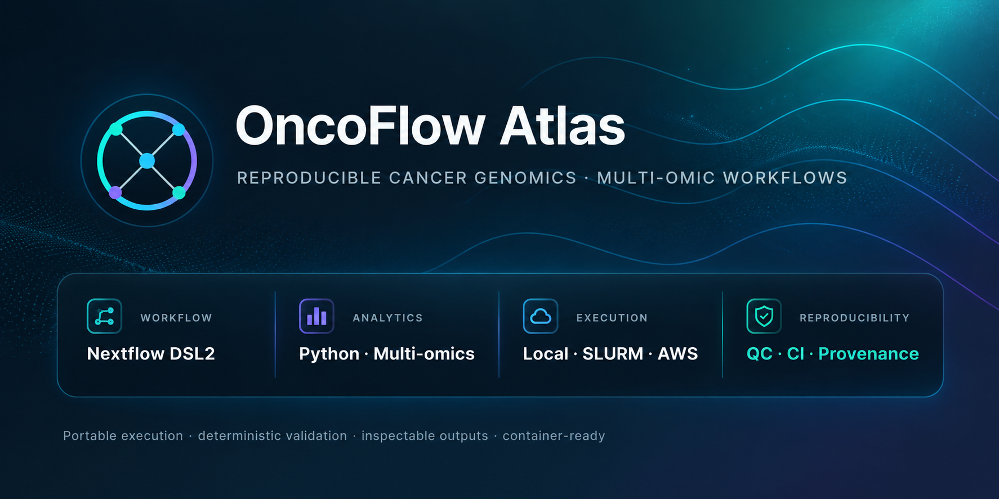
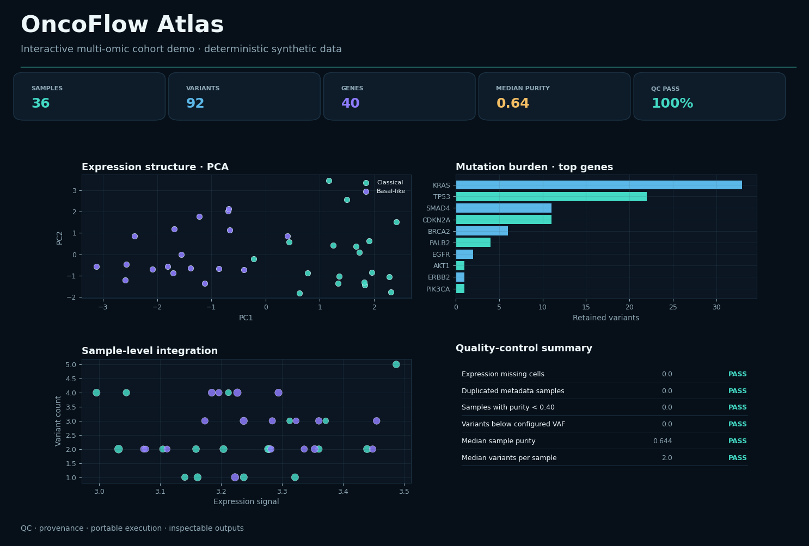
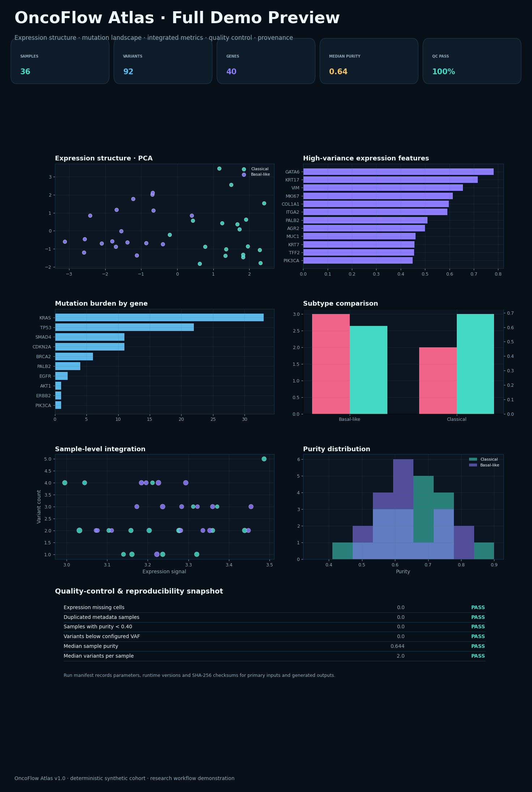
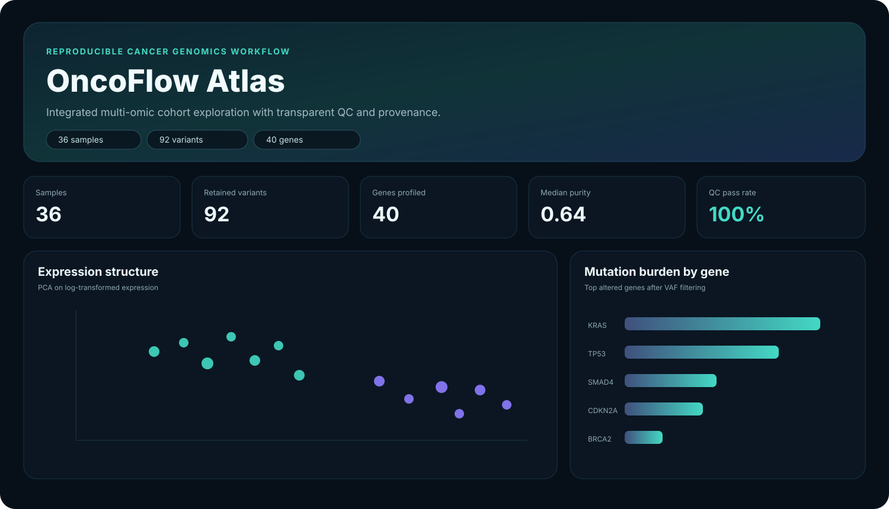
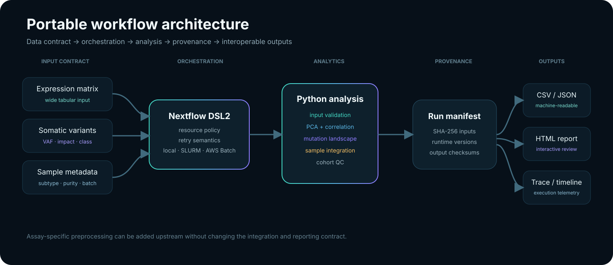

<p align="center">
  
</p>

<p align="center">
  <strong>Portable, inspectable and reproducible cancer-genomics workflow engineering.</strong>
</p>

<p align="center">
  <a href="https://github.com/sarvenaz-m/oncoflow-atlas/actions/workflows/ci.yml"></a>
  
  
  
  
</p>

<p align="center">
  <a href="https://sarvenaz-m.github.io/oncoflow-atlas/"><strong>Live project page</strong></a> ·
  <a href="https://sarvenaz-m.github.io/oncoflow-atlas/demo.html"><strong>Interactive example report</strong></a> ·
  <a href="docs/methodology.md"><strong>Methodology</strong></a> ·
  <a href="docs/reproducibility.md"><strong>Reproducibility</strong></a>
</p>

## Overview

**OncoFlow Atlas** is a compact reference implementation for reproducible multi-omic cohort analysis. It combines a **Nextflow DSL2** orchestration layer with a **Python** analytics/reporting layer and emphasizes the engineering concerns that make computational research transferable: validation, explicit parameters, deterministic test data, executor-independent configuration, provenance and machine-readable outputs.

The included example integrates an expression matrix, somatic-variant table and sample metadata into exploratory cohort views and a standalone interactive research report.

> The example cohort is synthetic and contains no patient data. The workflow is intended for research/software demonstration, not clinical diagnosis or regulatory-grade interpretation.


## Interactive demo

<p align="center">
  <a href="https://sarvenaz-m.github.io/oncoflow-atlas/demo.html">
    
  </a>
</p>

<p align="center">
  <strong><a href="https://sarvenaz-m.github.io/oncoflow-atlas/demo.html">Open the full interactive report →</a></strong>
</p>

The committed demo is produced by the repository itself from a deterministic synthetic cohort. It exposes the same result contract generated by a local, container, SLURM or AWS-oriented run: expression structure, mutation landscape, integrated sample metrics, quality-control summaries and run provenance.

| Cohort snapshot | Workflow evidence | Reproducibility | Execution |
|---|---|---|---|
| **36 samples · 40 genes** | PCA · heatmaps · mutation burden · oncoprint | input/output SHA-256 · deterministic seed · manifest | local · Docker/Singularity · SLURM · AWS Batch |

<details>
<summary><strong>View the full static demo preview inside GitHub</strong></summary>

<br/>



</details>

## Workflow at a glance

```text
Synthetic / tabular cohort inputs
        │
        ├── expression matrix ─────────┐
        ├── somatic variants ──────────┼──► validation + QC
        └── sample metadata ───────────┘          │
                                                  ▼
                                        multi-omic integration
                                                  │
                        ┌─────────────────────────┼──────────────────────────┐
                        ▼                         ▼                          ▼
                  PCA / expression          mutation landscape          sample metrics
                        └─────────────────────────┼──────────────────────────┘
                                                  ▼
                                     HTML + CSV/JSON + provenance
```

The analytical layer is intentionally decoupled from raw-assay preprocessing. Upstream WGS, RNA-seq, single-cell, spatial or long-read modules can therefore be connected through the documented tabular contracts without changing the core integration/reporting layer.

## Report preview

<p align="center">
  
</p>

The generated report includes expression structure, standardized high-variance features, sample correlation, mutation burden, variant-impact composition, mutation landscape, sample-level integration, subtype summaries and QC.

## Architecture

<p align="center">
  
</p>

The workflow intentionally keeps assay-specific preprocessing upstream of a simple tabular data contract. This makes it possible to replace or extend input modules without rewriting the integration and reporting layer.

## Core capabilities

- **Nextflow DSL2 orchestration** with modular processes
- executor profiles for **local**, **SLURM** and **AWS Batch** environments
- **Docker** image plus a Singularity-compatible Nextflow profile
- fail-fast schema, identifier and numeric-range validation
- configurable **VAF filtering** and top-feature selection
- expression PCA, standardized feature heatmap and sample-correlation analysis
- gene-level mutation burden, impact composition and sample × gene mutation landscape
- per-sample integration of expression signal, detected genes, purity and variant burden
- deterministic synthetic cohort for reproducible smoke testing
- SHA-256 provenance for primary inputs **and generated outputs**
- runtime capture for Python, NumPy, pandas and Plotly
- standalone interactive HTML reporting plus CSV/JSON result contracts
- automated tests and multi-version GitHub Actions quality gate
- Nextflow report, timeline and trace telemetry for orchestrated runs

## Quick start

### Python workflow

```bash
python -m venv .venv
source .venv/bin/activate
pip install -r requirements.txt

python bin/generate_demo.py \
  --outdir data/demo \
  --samples 36 \
  --seed 19

python bin/analyse_multiomics.py \
  --expression data/demo/expression.csv \
  --variants data/demo/variants.csv \
  --metadata data/demo/metadata.csv \
  --outdir results/demo \
  --cohort-name demo-cohort \
  --min-vaf 0.05 \
  --top-n 12
```

Open `results/demo/report.html` in a browser.

Or use:

```bash
make demo
```

### Nextflow

```bash
nextflow run main.nf -profile local -resume
```

HPC execution:

```bash
SLURM_QUEUE=compute nextflow run main.nf -profile slurm -resume
```

AWS Batch configuration is supplied through environment variables rather than committed credentials:

```bash
export AWS_BATCH_QUEUE=my-queue
export AWS_REGION=eu-west-1
export NXF_WORK=s3://my-bucket/oncoflow/work
nextflow run main.nf -profile awsbatch -resume
```

### Docker

```bash
docker build -t oncoflow-atlas:1.0 .

docker run --rm \
  -v "$PWD:/work" \
  -w /work \
  oncoflow-atlas:1.0 \
  python bin/analyse_multiomics.py \
    --expression data/demo/expression.csv \
    --variants data/demo/variants.csv \
    --metadata data/demo/metadata.csv \
    --outdir results/container-demo \
    --cohort-name container-demo
```

## Parameters

| Parameter | Default | Purpose |
|---|---:|---|
| `--cohort-name` | `demo-cohort` | Label written to report and provenance |
| `--min-vaf` | `0.05` | Exploratory somatic-variant VAF threshold |
| `--top-n` | `12` | Number of top features/genes shown in ranked views |

The same values are exposed as Nextflow parameters: `--cohort_name`, `--min_vaf` and `--top_n`.

## Output contract

| Output | Description |
|---|---|
| `report.html` | interactive cohort report |
| `cohort_summary.json` | compact machine-readable run summary |
| `run_manifest.json` | parameters, runtime versions, input/output SHA-256 hashes |
| `sample_metrics.csv` | sample-level integrated metrics |
| `pca_coordinates.csv` | reproducible PCA coordinates |
| `subtype_summary.csv` | cohort summaries grouped by subtype |
| `top_genes.csv` | highest-variance expression features |
| `variant_summary.csv` | gene-level variant counts |
| `qc_summary.csv` | interpretable cohort QC checks |

Nextflow executions additionally emit an execution **report**, **timeline** and **trace**.

## Repository structure

```text
.
├── .github/workflows/       # CI quality gate
├── assets/                  # hero, demo previews, architecture and social preview
├── bin/                     # deterministic generator + analysis CLI
├── config/                  # cohort schema
├── data/demo/               # synthetic example cohort
├── docs/                    # architecture, methodology, data contract, reproducibility
├── modules/                 # Nextflow DSL2 process modules
├── results/example/         # committed example outputs
├── tests/                   # contract, determinism and validation tests
├── CHANGELOG.md
├── CITATION.cff
├── Dockerfile
├── Makefile
├── main.nf
├── nextflow.config
├── pyproject.toml
└── requirements.txt
```

## Engineering principles

**Fail early.** Structural errors and impossible values stop execution before downstream analysis.

**Keep orchestration separate.** Executor configuration, resources and retry behavior live outside the analytical code.

**Make provenance an output.** Every run records its parameters, runtime versions and SHA-256 checksums.

**Retain inspectable intermediates.** Key tables remain available as CSV/JSON rather than being hidden behind a dashboard.

**Use synthetic data for portability.** Anyone can exercise the repository without controlled-access human data.

**Keep interpretation proportional to the method.** Outputs are exploratory and descriptive; the project does not present tabular demo analysis as a validated clinical pipeline.

## Quality checks

```bash
pytest -q
ruff check bin tests
```

The automated test suite covers:

1. end-to-end output contract,
2. deterministic data generation,
3. rejection of invalid purity values.

## Documentation

- [`docs/architecture.md`](docs/architecture.md) — components and extension points
- [`docs/data-contract.md`](docs/data-contract.md) — expected input schemas and constraints
- [`docs/methodology.md`](docs/methodology.md) — analytical choices and limitations
- [`docs/reproducibility.md`](docs/reproducibility.md) — provenance and execution model
- [`CONTRIBUTING.md`](CONTRIBUTING.md) — contribution expectations
- [`CHANGELOG.md`](CHANGELOG.md) — v1.0 feature record

## License

MIT License. See [`LICENSE`](LICENSE).
