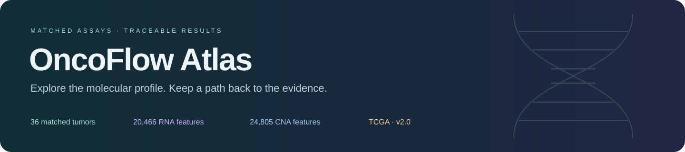
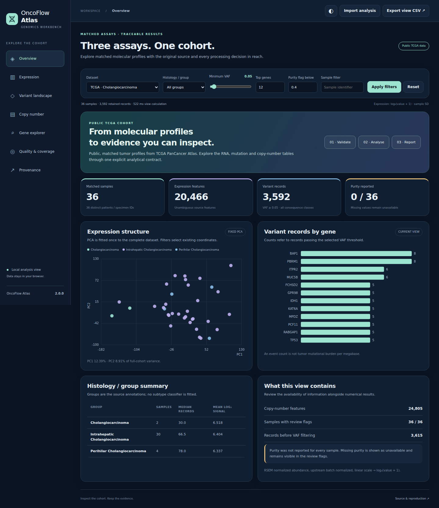
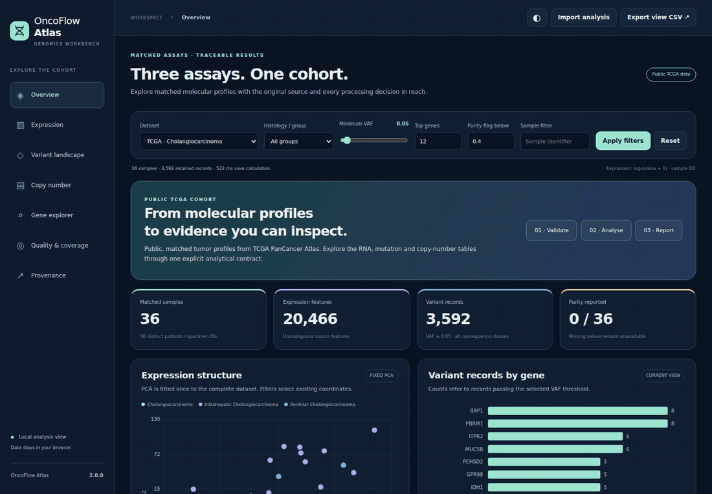
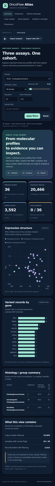

<p align="center"></p>

<p align="center">
  <a href="https://sarvenaz-m.github.io/oncoflow-atlas/"></a>
  <a href="docs/data-card.md"></a>
</p>

# OncoFlow Atlas

An offline genomics workbench and reproducible Python workflow for exploring **matched RNA expression, mutation records and copy-number calls**. Version 2 analyzes a pinned public TCGA cholangiocarcinoma cohort and keeps the original synthetic cohort as a separate software demonstration.

Filter the cohort, inspect a gene across all three assays, review missing information, and export the exact records behind the current view. The web report and Python calculations are tested against the same numerical contract.



**Explore:** [Workbench](https://sarvenaz-m.github.io/oncoflow-atlas/) · [Expression](https://sarvenaz-m.github.io/oncoflow-atlas/#expression) · [Gene explorer](https://sarvenaz-m.github.io/oncoflow-atlas/#gene) · [Data card](docs/data-card.md) · [Validation evidence](validation/README.md)

The live URL serves whichever commit is currently published by GitHub Pages. To preview this v2 package immediately, open `docs/index.html` locally; its data, scripts and plots are embedded and require no server.

## What the public run contains

| Input / output | Measured result |
|---|---:|
| Matched tumor specimens / distinct patients | 36 / 36 |
| RNA features retained | 20,466 of 20,531 |
| Discrete copy-number features retained | 24,805 of 25,128 |
| Mutation records before filtering | 3,615 |
| Records retained at VAF ≥ 0.05 | 3,592 |
| PCA variance, PC1 / PC2 | 12.39% / 8.91% |
| Reported purity values | 0 of 36 |

Source: [TCGA Cholangiocarcinoma, PanCancer Atlas](https://www.cbioportal.org/study/summary?id=chol_tcga_pan_can_atlas_2018), distributed through cBioPortal Datahub at revision `dca75cb3f32b82d54a6f78bf0a6323e5b975aca1`. RNA values are upstream batch-normalized RSEM abundance, not raw read counts. Missing purity stays missing. All source mutation consequence classes are retained before VAF filtering; these counts are **not tumor mutational burden per megabase**.

The analysis is descriptive: one cohort, no normal comparator, no fitted diagnostic or survival model. Numerical agreement and reproducibility are verified; external biological validation is outside this experiment.

## Explore the report

- **Overview:** matched cohort, fixed full-cohort PCA and retained variant records.
- **Expression:** genes ranked by selected-sample log-expression variance, gene-wise z-scores and sample correlations.
- **Variants:** mutation landscape, exact VAF boundaries and sensitivity at six thresholds.
- **Copy number:** all five GISTIC states; amplification/deletion counts refer to genes, not independent genomic events.
- **Gene explorer:** expression, mutation records and CNA calls for the same gene and specimens.
- **Quality & coverage:** input checks, feature exclusions, missing purity and sample review flags.
- **Provenance:** pinned source revision, input hashes, methods and portable exports.

<details><summary>Browser walkthrough and mobile view</summary>

The walkthrough uses captures from the functioning workbench.





</details>

## Reproduce the public analysis

Requires Python 3.11+; the release was executed with Python 3.12.14. The source tables and prepared cohort are included, so analysis can run without downloading patient-level files or requesting credentials.

```bash
python -m venv .venv
source .venv/bin/activate
python -m pip install -r requirements-lock.txt
python -m pip install --no-deps -e .

python scripts/prepare_public_data.py
python scripts/build_reports.py
```

On Windows, activate with `.venv\Scripts\activate` instead. For the supported dependency ranges rather than the release environment, install `requirements.txt` in place of `requirements-lock.txt`.

`build_reports.py` runs both datasets and creates `results/public/report.html`, `results/example/report.html` and the combined `docs/index.html`. The versioned web source is `src/oncoflow_atlas/web/`; edit it there and rebuild the generated HTML.

To download the pinned source again, use `python scripts/fetch_public_data.py --outdir data/public/source`. The downloader resolves Git LFS objects and verifies every source file's size and SHA-256. [Data provenance and license](DATA_LICENSE.md).

## Run your own cohort

```bash
oncoflow-atlas --expression expression.csv --variants variants.csv \
  --metadata metadata.csv --cna cna.csv --outdir results/my-cohort \
  --cohort-name my-cohort --min-vaf 0.05 --top-n 12
```

CNA is optional. Supply linear-scale expression with the units documented for your dataset; log-transformed inputs are not detected automatically. Exact specimen matching and one specimen per patient are required. [Input contract](docs/data-contract.md).

## Validate the implementation

Python development dependencies and Node.js 20+ are needed for cross-language checks.

```bash
python -m pip install -r requirements-dev.txt
python -m ruff check src scripts bin tests
python -m pytest -q
OPENBLAS_NUM_THREADS=1 python scripts/verify_public_results.py
npm ci
npx playwright install chromium
npm run test:browser
```

The independent verification reconstructs the prepared CSVs from pinned source bytes, compares PCA with scikit-learn, standardization/correlation with SciPy, and compares Python and JavaScript in 27 public/synthetic filter scenarios. [Recorded results and limitations](validation/README.md).

## Run the staged workflow

The Nextflow DSL2 graph has separate **validate → analyse → render** processes and rejects analysis inputs that changed after validation.

```bash
nextflow run main.nf -profile public,local --outdir results/nextflow-public
nextflow run main.nf -profile public,local --outdir results/nextflow-public -resume
```

The Python stages were executed and compared with the direct run. Nextflow 26.04.6 parsed the graph here, but its local child-process launch failed in the build environment; an end-to-end Nextflow success is **not claimed**. CI includes a real Nextflow run and cache-resume check. Docker and SLURM profiles are supplied but have not been executed for this release. [Reproduction details](docs/reproducibility.md).

## Project structure

| Path | Purpose |
|---|---|
| `src/oncoflow_atlas/` | Validation, computation, CLI and shared report renderer |
| `src/oncoflow_atlas/web/` | Browser calculations, workbench and native SVG charts |
| `data/public/source/` | Original pinned public source bytes and study notice |
| `data/public/prepared/` | Matched CSVs, feature exclusion ledger and source manifest |
| `config/` | Source lock and explicit analytical protocol |
| `results/public/` | Executed public analysis, CSVs and output hashes |
| `results/example/` | Separate synthetic software example |
| `validation/` | Independent numerical and browser evidence |
| `docs/` | Offline Pages build, methods and data documentation |

This project demonstrates reproducible preprocessing, numerical analysis, software validation and an inspectable interface for biomedical data. The methods, source selection and implementation are documented separately so each can be reviewed.

## Attribution and licensing

Software and authored synthetic examples: [MIT](LICENSE). Public source and adapted data: [separate data terms](DATA_LICENSE.md), including ODbL 1.0 and the retained TCGA study notice. Cite both the software and original data when using results. [Software citation](CITATION.cff) · [cBioPortal data terms](https://github.com/cBioPortal/datahub#license) · [TCGA PanCancer publications](https://gdc.cancer.gov/about-data/publications/pancanatlas).
