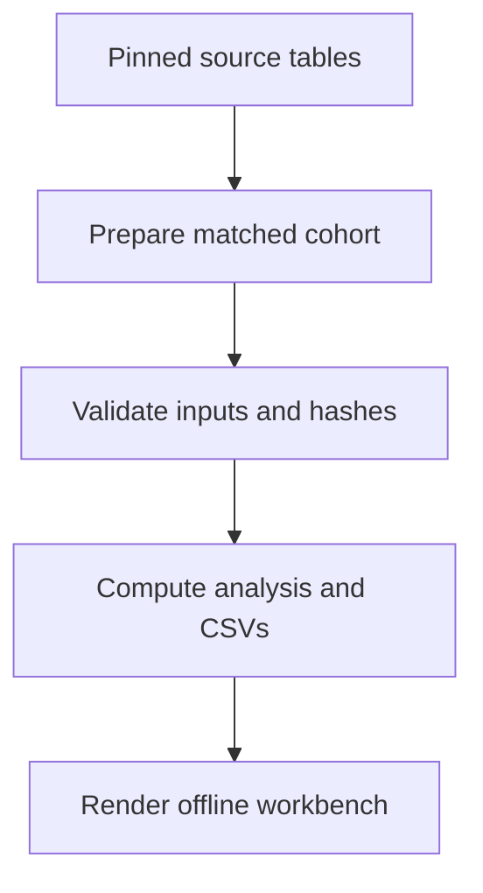

# Workflow architecture

`public_data.py` selects and transforms the pinned public cohort. `validation.py` owns the structural/numeric contract. `analysis.py` calculates the full-cohort PCA and filtered views. `reporting.py` embeds data and the browser source into a portable report. `cli.py` exposes independent stages as well as a direct run.

Nextflow stages mirror validation, analysis and rendering. Analysis verifies hashes emitted by validation, so a changed input cannot use a stale validation artifact. Source code is a workflow input and `cache = 'deep'` uses content for file inputs. Report rendering produces the final directory for publication. Nextflow execution status for this release is documented in `validation/README.md`.

The browser's `analysis.js` implements the declared view calculations separately; Python/JavaScript parity is tested. PCA is computed in Python and stored once. `app.js` renders native SVG, accessible labels and data tables. No plotting CDN, web font, backend or analytics endpoint is required. Python rendering and GitHub Pages use the exact same template and scripts.

The only versioned browser source is under `src/oncoflow_atlas/web/`. Generated HTML contains everything needed to open with `file://` or serve through GitHub Pages. Large table previews show the first 200 rows and identify the total; the full ranked table remains in the current-view JSON download.
